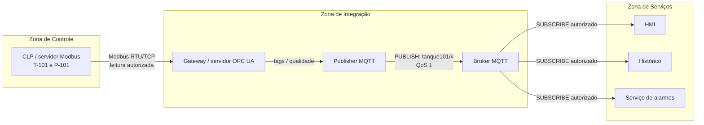

# Arquitetura integrada (Mermaid)

**Controles:** segmentação e firewall entre zonas, TLS, identidade e ACLs no broker; broker não acessa diretamente o CLP. Os permissivos e intertravamentos ficam no controlador local.
